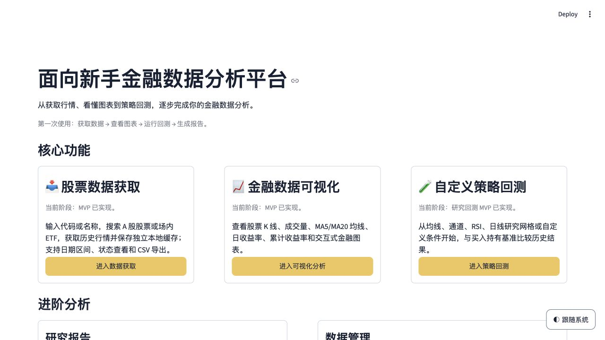

# 面向新手金融数据分析平台

一个基于 Python、Pandas、Plotly 和 Streamlit 的本地 A 股与场内 ETF 研究工具。它把**行情获取、数据缓存、图表分析、策略回测和研究报告**放在同一个浏览器界面中，帮助初学者按清晰步骤完成一次可复现的金融数据分析。

> 适合学习、课程实践和作品集展示。项目不连接券商账户，不执行实盘交易，不预测未来收益。



## 快速导航

- [项目能做什么](#项目能做什么)
- [安装与启动](#安装与启动)
- [第一次使用](#第一次使用)
- [数据来源与本地缓存](#数据来源与本地缓存)
- [项目结构](#项目结构)
- [测试与质量](#测试与质量)
- [完整使用说明](docs/01-getting-started/01-USER_GUIDE.md)
- [文档中心](docs/README.md)

## 项目能做什么

平台围绕一条完整的研究流程设计：

```text
搜索 A 股 / ETF
    → 选择日期与复权方式
    → 获取并校验历史行情
    → 保存本地缓存
    → 查看图表与统计指标
    → 运行研究回测
    → 生成结构化研究报告
```

### 1. 股票与 ETF 数据获取

- 支持6位A股和场内ETF代码搜索，也支持中文名称搜索。
- 可分别设置开始日期、结束日期，或选择“至今”和常用快捷区间。
- 支持前复权和后复权请求，并记录接口实际返回的价格口径。
- 标准化日期、开盘、最高、最低、收盘、成交量和成交额。
- 优先读取本地缓存，仅在用户明确点击按钮后请求网络。
- 支持永久保存、仅本次使用和CSV下载。
- 网络失败时保留已有缓存，不会把旧数据标记为本次最新数据。

### 2. 金融数据可视化

- K线、成交量、MA5、MA20。
- 日收益率、累计收益率和最大回撤。
- 区间累计收益、平均日收益、年化波动率和有效交易日统计。
- Plotly缩放、悬停、图例切换、时间范围滑块和单图重置。
- 缺失成交数据保留为空值并明确提示，不静默补零。
- 指标结果可导出为CSV。


### 3. 自定义策略回测

内置以下研究策略：

- 双均线交叉。
- 价格通道突破。
- RSI阈值。
- 日线研究网格。
- 可组合“且 / 或”关系的自定义条件策略。

回测采用**当日收盘形成信号、下一交易日开盘模拟执行**的时序，包含手续费、滑点、现金、持仓、整手约束、未成交订单、买入持有基准和交易日志。结果支持CSV与ZIP导出。

> 当前采用归一化研究价格和简化成交假设，用于教学与历史研究，不能当作可直接实盘执行的收益结果。


### 4. 研究报告

- 复用已缓存行情、Python统计指标和回测结果。
- 支持历史表现、技术指标、双均线回测和综合报告。
- 未配置模型API时，可以生成明确标识的本地规则报告。
- 配置兼容接口后，只在用户点击生成按钮时调用模型。
- Python核验证券代码、名称、日期和关键数值；验证失败时回退规则报告。
- 支持Markdown报告和指标CSV下载。


### 5. 数据与配置管理

- 查看永久缓存和本次临时缓存。
- 批量移入回收区、恢复缓存和结束临时会话。
- 保存、删除和恢复自定义策略。
- 保存模型名称与API地址；API Key可选择存入操作系统钥匙串。
- 深色、浅色和跟随系统三种外观模式。

## 安装与启动

### 环境要求

- 推荐 Python 3.11。
- 能访问所选行情数据源的网络环境。
- 现代浏览器，例如 Chrome、Edge、Firefox 或 Safari。

项目使用跨平台Python和Streamlit运行。当前主要验证环境是macOS Apple Silicon；Windows和Linux使用相同业务代码，只需采用各自的虚拟环境激活命令并成功安装依赖。

### macOS / Linux

```bash
cd /path/to/your/project
python3 -m venv .venv
source .venv/bin/activate
python -m pip install --upgrade pip
python -m pip install -r requirements.txt
python -m streamlit run app.py
```

### Windows PowerShell

```powershell
cd C:\path\to\your\project
py -3.11 -m venv .venv
.\.venv\Scripts\Activate.ps1
python -m pip install --upgrade pip
python -m pip install -r requirements.txt
python -m streamlit run app.py
```

如果PowerShell不允许执行激活脚本，可在CMD中使用：

```bat
.venv\Scripts\activate.bat
python -m streamlit run app.py
```

启动成功后，Streamlit通常会自动打开浏览器。若没有自动打开，请访问：

```text
http://localhost:8501
```

停止程序时，在运行Streamlit的终端按 `Ctrl+C`。

### VS Code一键启动

1. 用VS Code打开项目根目录。
2. 安装官方Python扩展。
3. 选择项目虚拟环境中的Python解释器。
4. 打开“运行和调试”。
5. 选择“Streamlit: 新手金融数据平台（启动并打开浏览器）”。

调试配置不写死macOS解释器路径，因此Windows、Linux和macOS都使用VS Code当前选中的解释器。

## 第一次使用

推荐按以下顺序体验：

1. 进入“股票数据获取”，选择A股或ETF。
2. 输入证券代码或中文名称，并从结果中明确选择证券。
3. 设置日期区间、复权方式和保存方式。
4. 点击“获取数据”，检查来源、覆盖日期、记录数和成交字段状态。
5. 进入“金融数据可视化”查看价格、成交量、收益和回撤。
6. 进入“自定义策略回测”选择策略、阅读参数说明并运行回测。
7. 进入“研究报告”生成本地规则报告，或配置自己的模型API。
8. 在“数据管理”中管理缓存、策略和模型配置。

更详细的逐页说明、指标解释和常见问题见[使用说明书](docs/01-getting-started/01-USER_GUIDE.md)。

## 数据来源与本地缓存

| 数据 | 当前实现 | 说明 |
| --- | --- | --- |
| A股代码表 | AKShare | 用户明确搜索或刷新时获取并缓存 |
| ETF代码表 | AKShare封装的新浪、同花顺来源 | 合并可用清单，单一来源失败会明确提示 |
| 前复权/后复权OHLC | 腾讯公开K线接口 | 记录实际返回的`qfqday`、`hfqday`或`day` |
| 成交量与成交额 | 新浪历史行情补充 | 按日期和成交量校验后合并，不匹配时保留缺失 |
| 交易日期 | AKShare / 新浪provider-derived日期 | 仅作离线研究辅助，不声明为交易所权威日历 |
| 研究报告模型 | 用户自行配置的兼容API | API Key不写入仓库 |

主要本地目录：

```text
data/stocks/           永久行情与证券代码表缓存
data/session_cache/    本次会话的临时行情
data/cache_recovery/   可恢复的缓存回收区
data/user_strategies/  本地自定义策略
data/model_profiles/   模型名称和API地址，不包含API Key
```

这些运行数据已加入`.gitignore`，不会作为项目源码提交。关闭浏览器不保证瞬间删除临时数据；会话失去活跃信号后由清理任务回收，下次启动也会处理过期目录。

## 项目结构

```text
app.py                         Streamlit入口与页面路由
src/
├── stock_data/                证券搜索、行情接口、标准化、缓存和数据管理
├── stock_analysis/            金融指标与Plotly图表
├── backtest/                  策略信号、模拟执行、绩效和导出
├── ai_report/                 结构化事实、模型调用、输出验证和报告
├── navigation.py              页面状态与导航
├── date_controls.py           日期区间与完整日线控制
├── ui_experience.py           外观、按钮与图表交互
└── time_utils.py              北京时间工具
config/
└── trading_calendar.json      本地交易日期参考
tests/                         离线单元测试与Streamlit页面测试
docs/                          分类文档、验证记录和页面截图
```

核心原则：

- 页面与业务计算分离。
- 行情获取、缓存、指标、回测和报告分别封装。
- 页面重新渲染不会自动下载行情或调用模型。
- 不混合不同证券、资产类别和复权方式的缓存。
- 关键金融指标由Python计算，模型只负责受控语言组织。

## 测试与质量

当前完整离线测试结果：

```text
293 passed
```

运行测试：

```bash
python -m pytest -q -p no:cacheprovider
```

测试覆盖：

- 股票与ETF搜索、代码校验和缓存命中。
- 网络失败、空数据、字段缺失、重复日期和安全写入。
- 收益率、均线、波动率和最大回撤。
- 多种策略信号、下一交易日执行、成本、现金和持仓。
- 无前视偏差的人工价格序列。
- 研究报告结构、数值引用和失败回退。
- Streamlit导航、页面状态和重复渲染行为。

测试使用Mock和固定样例离线运行，不依赖真实行情或LLM网络。详细验证记录见[文档中心](docs/README.md)。

## 使用边界

- 不提供实盘下单或券商连接。
- 不承诺收益，也不把历史表现描述为未来趋势。
- 复权价格适合历史研究，但不等于真实可成交价格。
- 简化回测未完整建模公司行为、税费、涨跌停和市场冲击。
- 免费或公开接口可能因网络、限流或上游字段变化而暂时不可用。
- 数据来源和核验状态会在页面中展示；接口失败不会自动生成伪造行情。

## 文档

文档已按主题和阅读顺序整理：

1. [快速开始与完整使用说明](docs/01-getting-started/01-USER_GUIDE.md)
2. [数据来源、成交字段与缓存](docs/02-data-and-cache/01-MARKET_DATA.md)
3. [金融数据可视化](docs/03-visualization/01-VISUALIZATION.md)
4. [策略回测设计与假设](docs/04-backtesting/01-BACKTEST.md)
5. [研究报告与输出核验](docs/05-research-reports/01-RESEARCH_REPORT.md)
6. [工程记录与源码来源审计](docs/06-engineering-records/05-SOURCE_PROVENANCE.md)
7. [完整文档索引](docs/README.md)

## 作者与许可

- 作者与维护者：[Skyyyyyy](https://github.com/skyshi7179)
- 许可证：[MIT License](LICENSE)
- 版权所有：`Copyright (c) 2026 Skyyyyyy (GitHub: skyshi7179)`

项目早期学习过程中参考过`JA0508/fund-flow-monitor`。原板块资金流系统已经完整删除，当前版本的来源审计未发现上游实质性业务源码。历史参考和第三方依赖说明见[THIRD_PARTY_NOTICES.md](THIRD_PARTY_NOTICES.md)，审计过程见[源码来源审计](docs/06-engineering-records/05-SOURCE_PROVENANCE.md)。
