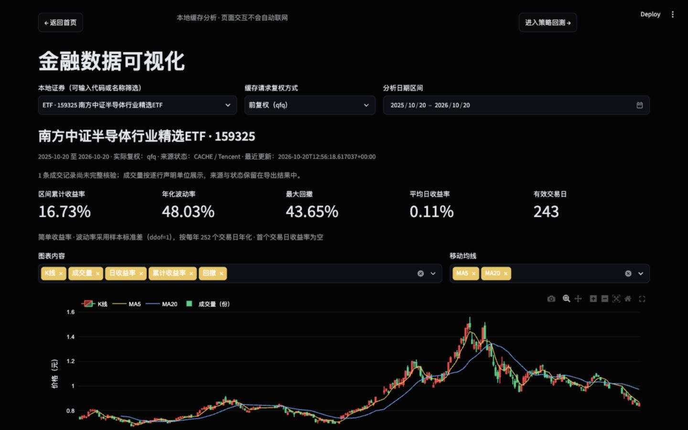
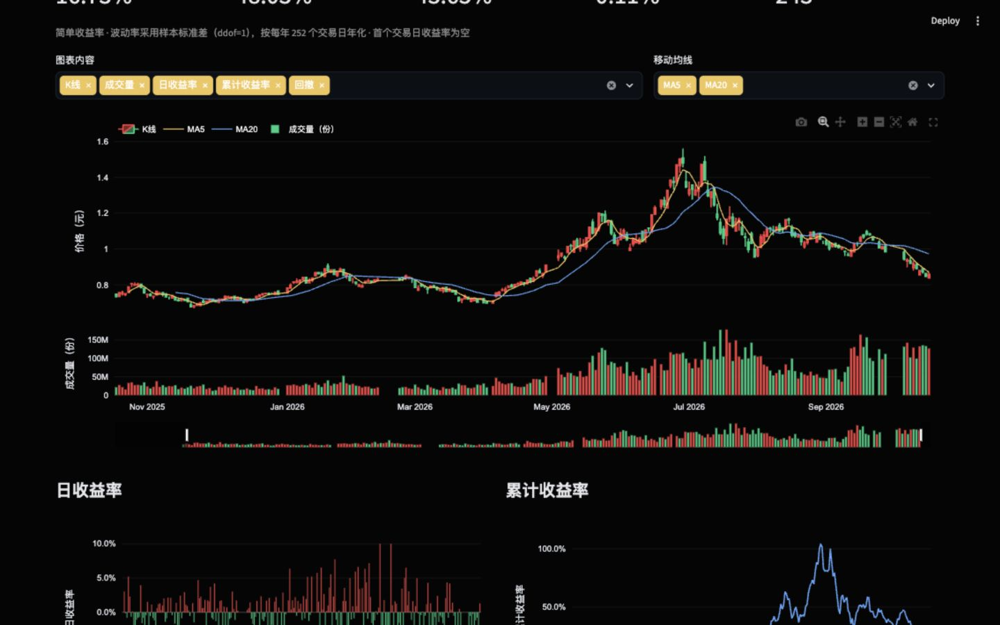
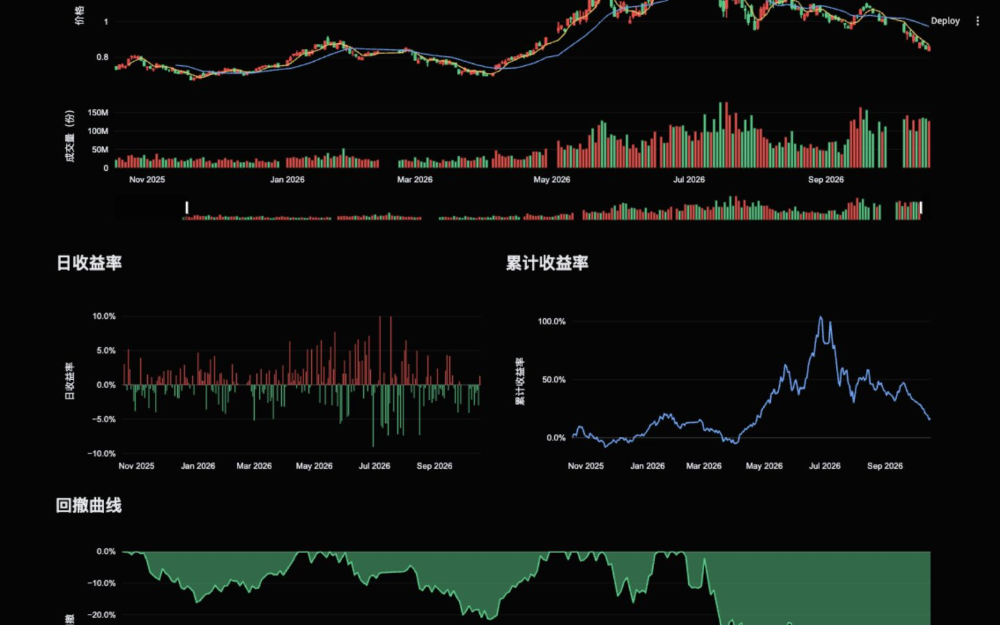

# 金融数据可视化：指标、图表与验证

验收日期：2026-10-20。数据来源是用户已保存的本地真实行情缓存，本阶段没有调用行情下载接口，也没有新增样例冒充真实数据。

## 使用

```bash
cd "/Users/sky/Documents/Study/项目1-1"
.venv/bin/python -m streamlit run app.py
```

从首页点击“进入可视化分析”，选择已缓存证券、缓存请求复权方式及日期。也可在数据获取页选择证券、日期后点击“前往可视化分析”。缺少缓存时使用“前往数据获取”入口。

可选 K 线、成交量、日收益率、累计收益率、回撤；MA5/MA20 可独立开关，图例也可切换曲线。K 线与成交量共享日期轴，底部有时间范围滑块，支持拖动缩放、滚轮缩放、悬停及复位。收益与回撤图展示同一分析区间，可分别缩放。

“下载指标计算结果 CSV”包含逐日指标、来源、实际复权、成交单位与区间统计。收益以小数保存，0.05 表示 5%；首日收益率、未满窗口的 MA、样本不足的波动率保持空值。源缓存不会被本页改写。

进入策略回测按钮仅通往原有待开发页面，本阶段未实现或运行任何策略。

## 结构及复用

| 文件 | 职责 |
| --- | --- |
| `src/stock_analysis/indicators.py` | 纯计算与输入校验：`calculate_indicators`，不读文件、不联网、不依赖 Streamlit |
| `src/stock_analysis/charts.py` | `build_price_chart`、`build_return_chart`，只消费计算结果 |
| `src/stock_analysis/page.py` | 缓存选择、状态提示、指标与图表呈现、下载、导航 |
| `src/stock_data/service.py` | 新增本地缓存目录清单；复用原有 `read_stock_history_cache` 统一读取接口 |
| `src/stock_data/context.py` | 非 widget 状态保存证券、日期、请求复权方式，避免页面切换时被 Streamlit 清理 |
| `src/stock_data/page.py` | 恢复共享研究条件，新增进入可视化入口 |
| `src/navigation.py`、`app.py` | 将可视化占位页接入现有导航，首页仍为默认入口 |
| `tests/test_stock_visualization.py` | 数学、图表、只读缓存与页面状态回归 |

另外更新README功能清单和`tests/test_navigation.py`中的可视化页面断言；截图现统一保存在`docs/08-assets/screenshots/`。该开发记录没有创建提交或推送。

股票图表使用独立的 `src/chart_theme.py` 颜色常量与 Plotly 布局，K线、成交量和收益图均只消费标准化OHLCV及指标结果。

```text
本地缓存清单 → 用户选择证券 / 日期 / 请求复权方式
            → read_stock_history_cache（只读）
            → calculate_indicators（校验并计算）
            → Plotly 图表 + 摘要 + 指标 CSV
```

## 指标定义

设所选区间清洗后的收盘价为 C₀,…,Cₙ₋₁。所有窗口都局限于所选样本，不读取起点以前数据预热均线，也不使用未来值。

| 指标 | 定义与边界 |
| --- | --- |
| 日收益率 | rₜ = Cₜ / Cₜ₋₁ − 1；简单收益率，首项 NaN，`pct_change(fill_method=None)` |
| MA5 / MA20 | 过去 w 个样本含当期收盘价的算术平均；`rolling(w, min_periods=w)`，窗口不足 NaN |
| 累计净值 | Vₜ = Cₜ / C₀，起点为 1 |
| 累计收益率 | Vₜ − 1，起点为 0；摘要取末项 |
| 回撤 | Dₜ = Vₜ / max(V₀,…,Vₜ) − 1，曲线非正 |
| 最大回撤 | −min(Dₜ)，摘要显示正的损失幅度 |
| 年化波动率 | 有效 rₜ 的样本标准差（ddof=1）× √252，至少需要 2 个收益观测 |
| 平均日收益率 | 有效 rₜ 的算术平均；无收益观测时不计算 |
| 有效交易日 | 有有效 OHLC 且非已知零成交的记录数；n 条价格一般对应 n−1 个收益观测 |

年化采用 252 个交易日的约定，不表示数据经过交易所日历完整性验证。日期空档不补齐，两个有效记录之间的收益可能跨越停牌或缺失交易日，不能将其理解为每个自然日的收益。本页不计算含分红现金流或交易费用的总回报。

## 数据保护与不足提示

- OHLC 缺失、非数值、无穷、非正价格、高低价关系异常，均提示错误并阻止收益计算，不填补价格。
- 所选区间证券、价格来源或实际复权方式混用时，阻止计算，提示缩短区间或统一数据。
- 301660 等返回 `day` 的缓存按实际 `none` 计算，并显示原始价格说明；不把请求的 qfq/hfq 当作真实返回方式。
- 完全相同的重复日期去重；同日期 OHLCV 冲突阻止计算；按日期排序后计算。
- 已知零成交记录按非交易观测排除并提示，不能仅凭这点认定交易所正式停牌。
- 成交量缺失、非数值、无穷或负数：不推断停牌，保留有效价格，成交量显示缺口并提示。
- 成交量单位 UNKNOWN 或混用：隐藏成交量图并提示刷新；价格指标可以继续展示。来源未完整核验的成交记录有单独提示。
- 空数据、单条数据、短于均线窗口均能展示明确状态；一个价格点的区间收益和回撤为 0，但平均收益与波动率不可计算。
- 缓存覆盖不足时只分析实际可读记录，明确提示；目录元数据损坏也会显示消息，不触发下载。
- Streamlit widget 状态之外保存 `research_context` 和图表偏好，支持首页往返、数据获取与可视化切换。

## 实际验证

命令：

```bash
.venv/bin/python -m pytest -q -p no:cacheprovider
```

该功能完成时的专项回归输出为`96 passed in 34.96s`，失败0项，其中包含28项可视化专项测试。当前全量结果以根目录README为准。

主要检查：

- 固定价格 `[100,110,99,120,90]`：区间收益 −10%，最大回撤 25%，逐日收益及样本波动率与手算定义一致。
- MA5/MA20 窗口、仅使用所选区间基准；追加极端未来价格不改变已有逐日指标。
- 空、单点、平价、上涨、下跌、零成交、缺失/异常价格、复权混用、重复日期。
- K 线与成交量 x 序列一致、共享轴、单位、MA 开关及时间滑块。
- AppTest 阻断网络入口，验证缓存选择、日期调整、图表开关、首页往返、进入数据获取及回测占位页不触发下载。

真实缓存检查：本机 301660（6 条）、159325（243 条）、159516（242/243 条）可进入计算流程，数据均来自已有缓存，没有重新下载。旧缓存中成交量单位未声明时，页面正确提示且不绘制成交量。

浏览器验收：本地 `127.0.0.1:18501`，1440×900 桌面视口。159325 qfq，2025-10-20 至 2026-10-20，243 条：页面累计收益 16.73%、年化波动率 48.03%、最大回撤 43.65%、平均日收益 0.11%。这些是该缓存样本的描述统计，不是预测或投资建议；最后一条成交记录未完整核验，页面单独提示。

浏览器实际点击下载，获得 `159325_2025-10-20_2026-10-20_indicators.csv`，读取验证为 243 行，首项日收益为空、MA20 前 19 项为空。导出区间累计收益为 0.1673469387755102，最大回撤为 0.4364604125083168，有效交易日 243，与页面摘要一致。下载文件保存在用户本机 Downloads，没有加入 Git。浏览器首页往返也确认证券、日期及复权选择保留。

## 页面截图

真实缓存总览：



K 线、均线与成交量共享日期轴：



收益率与回撤：



## 面试解释

页面不承担金融计算，也不直接调用行情接口。统一缓存服务保证输入来源可追溯，纯函数计算便于手算验证和离线测试，Plotly 只负责交互展示。把请求复权与实际复权分开，是为了避免原始价格回退或旧缓存混用造成看似正常、实际口径不一致的收益曲线。
