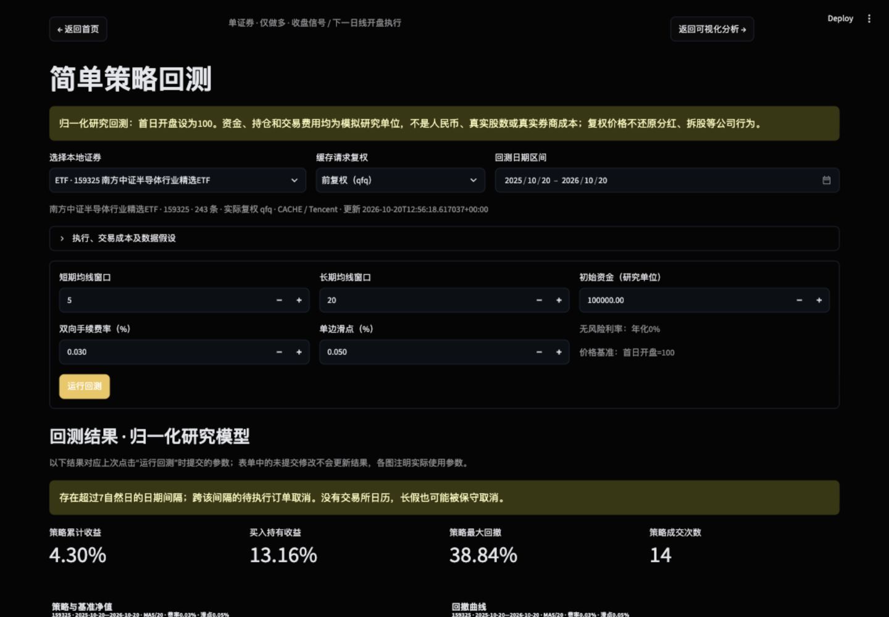
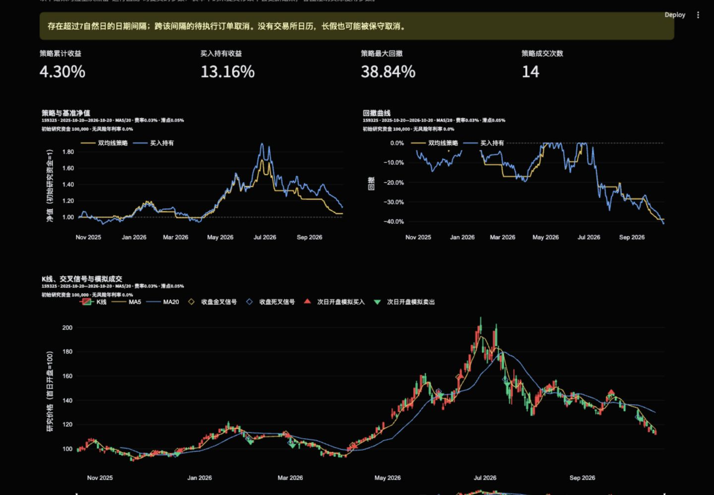

# 策略回测：设计、假设与验证

记录日期：2026-10-20。项目目录为 `项目1-1`。本阶段仅新增研究回测，未接券商或实盘交易。

## 1. 如何运行

停止已有 Streamlit 进程（其终端按 Control+C），然后重新启动，以避免旧进程保留修改前的模块导入：

```bash
cd "/Users/sky/Documents/Study/项目1-1"
.venv/bin/python -m streamlit run app.py
```

首页 → 进入策略回测 → 选择本地证券、复权缓存与日期 → 配置 MA、初始研究资金、费率和滑点 → 点击“运行回测”。无缓存时前往数据获取，回测页自身不会联网。默认 MA5/20 至少要求21个可交易观测；只有6条数据的新上市证券不能用于该默认配置。

可返回首页、可视化页，保留研究选择与已提交参数。表单中未提交的修改不改变已有结果；证券、区间、已提交参数或缓存内容变化后，必须重新运行。页面重绘不会重复回测或下载。

## 2. 研究口径与边界

**这是归一化研究回测，不能解释为真实人民币、真实股数或精确可执行收益。** 输入可能为前复权、后复权或不复权，逐行实际复权口径、证券和来源必须一致；请求复权方式与实际复权方式均在页面/导出中保留。

- 研究价格 `P[t] = 输入价格[t] / 所选区间首日输入开盘价 × 100`，四个 OHLC 使用同一常数。只使用已知首日开盘基准，不用未来价格归一化。原始 OHLC 另存 `input_open/high/low/close`。
- 初始研究现金默认100,000、策略初始持仓0、初始无待执行订单。不借款、不卖空、不计现金利息。价格归一化后，模拟持仓数量不是真实股票股数。
- 当前收盘计算短/长简单移动均线。`短MA-长MA` 从不大于0变为大于0是金叉；从不小于0变为小于0是死叉。初次得到完整均线但已经在上方不自动入场。
- 收盘信号交给下一条缓存日线开盘执行；**不在信号当日收盘成交**。未使用所选区间之前的数据预热。均线不足窗口保留 NaN；无效/零成交日中断窗口，重新积累足够有效观测后恢复信号。
- 买入以研究开盘价乘 `(1+滑点)`，卖出乘 `(1-滑点)`；默认滑点0.05%。默认双向手续费为模拟成交额的0.03%，无最低费用。
- 买入数量为 `floor(现金/[含滑点成交价×(1+费率)]/100)×100`；不足100模拟单位则拒绝，现金不变。已有持仓不重复买入。卖出一次清空全部模拟持仓（包括模拟零股）；空仓卖出记为忽略。
- 100模拟单位是本版统一约定，不能覆盖全部 A 股板块/ETF 的交易规则。例如[上交所现行基金相关交易规则](https://www.sse.com.cn/lawandrules/sselawsrules2025/fund/trading/c/c_20260424_10817739.shtml)列示的科创板股票竞价申报数量规则与普通100股整手规则不同。
- 下一日线价格无效、零成交、负/缺失成交量时订单取消，不顺延。存在有效收盘但其他 OHLC 无效的记录仍用于持仓估值，不形成信号；缺失或非正收盘则拒绝整个回测。日期冲突拒绝，完全相同 OHLCV 的重复日期去重。
- 连续性使用项目内provider-derived交易日历核对：国庆等已声明休市日期不会被当成缺失；中间存在已声明开市日却没有行情时，跨缺口条件不可判断且待执行订单取消。超出日历覆盖时明确标为“日历未核验”并保守取消，不冒充缺失或正常连续。该日历不是交易所权威日历。
- 最后一日信号无下一开盘机会，记为 `UNFILLED_END`。不强制末日平仓，持仓按最后收盘估值，因此未收取假设性最终卖出成本。
- 买入持有基准在首个可交易开盘按同样手续费、滑点和整手规则一次买入，余款保留；持有至末日估值。成交次数按成交委托数计，买/卖分别计数，不是往返次数。
- 原始成交量仅判断可交易性，不用于容量/成交比例限制。未建模分红、送股、拆并股、印花税、过户费、涨跌停、真实流动性等。复权价可能事后修订，不是 point-in-time 历史快照；引擎无未来行泄漏不等于上游数据绝无历史修订。

## 3. 核心数据流与文件

```text
已有 data/stocks 缓存（只读）
  → list_cached_stock_history / read_stock_history_cache
  → prepare_bars：校验实际口径/日期/OHLCV、归一化、可交易性
  → generate_ma_signals：历史滚动均线及收盘交叉
  → run_backtest：上日订单在本日开盘处理，再计算本日收盘信号与账户
  → portfolio_statistics：策略/基准各自的收益、净值与回撤
  → Plotly 图表、Streamlit 表格、CSV/ZIP
```

| 文件 | 职责及主要函数 |
| --- | --- |
| `src/backtest/engine.py` | `BacktestParams`、`prepare_bars`、`generate_ma_signals`、`execute_order`、`run_backtest`；独立于 UI 的账户及订单引擎 |
| `src/backtest/metrics.py` | `portfolio_statistics`；统一统计策略与基准，不擦除首日成本 |
| `src/backtest/charts.py` | `build_portfolio_chart`、`build_trade_chart`；图区分收盘信号与次日实际模拟成交 |
| `src/backtest/export.py` | `export_run`；打包每日账户、信号订单、成交、基准、绩效和假设 |
| `src/backtest/page.py` | 本地读取、参数表单、显式运行、状态保留和下载，缓存内容摘要参与结果身份判断 |
| `src/backtest/__init__.py` | 对后续模块暴露参数、结果、运行函数 |
| `src/stock_analysis/charts.py` | 将已有图表布局公开为 `apply_chart_layout`，供两页复用；现有图表行为保留 |
| `app.py` / `src/navigation.py` | 将已有回测入口接到实际页面，更新首页阶段状态 |
| `tests/test_backtest.py` | 人工小序列验证引擎、费用、指标与无前视偏差 |
| `tests/test_backtest_page.py` | 离线 AppTest、网络调用禁止、按钮/状态/图表/导出检查 |
| `tests/test_navigation.py` / `tests/test_stock_visualization.py` | 更新回测入口已实现的断言 |

结果中的 `strategy_cash/shares/equity/nav/daily_return/drawdown` 为策略逐日账户；`benchmark_*` 为基准。订单保留 `signal_date`、`scheduled_date`、`execution_date`、方向、状态、拒绝原因、研究成交价、数量、费用及成交后账户。

## 4. 绩效公式

记初始现金为 `C0`，每日收盘总资产 `Et=现金t+模拟持仓t×研究收盘价t`，`Vt=Et/C0`，交易前净值为1，共有 N 条输入日线。

| 指标 | 定义 |
| --- | --- |
| 日收益 | 第一个观测 `r0=V0-1`；之后 `rt=Vt/V(t-1)-1`。首日开盘成本及开盘至收盘变动都计入 |
| 累计收益 | `VT-1` |
| 年化收益 | `VT^(252/N)-1`，按观测数约定年化，不是自然日年化 |
| 年化波动率 | `std(r, ddof=1)×sqrt(252)` |
| 回撤曲线 | `Vt/max(1,V0,…,Vt)-1` |
| 最大回撤 | 回撤曲线最小值取负；初始资金1纳入历史峰值 |
| 夏普比率 | `sqrt(252)×mean(r-rf_daily)/std(r,ddof=1)`；`rf_daily=(1+rf_annual)^(1/252)-1`，UI 默认年化无风险利率0%；零波动时为空 |
| 成交次数 | `FILLED` 委托数量，买入持有通常为1次 |

均线 `MAw(t)=mean(close[t-w+1:t])`，最少需要 w 个连续有效样本。复权方式与输入保持一致，不在回测页自行改变复权方式。

## 5. 实际验证记录

环境：macOS 27.0.1 arm64；Python 3.11.15；Pandas 3.0.6、NumPy 2.4.6、Plotly 7.1.0、Streamlit 1.66.0、AKShare 1.19.1。未新增依赖。工作区无已提交基线，执行前后均为既有未跟踪项目文件；未提交、推送或重置。

### 离线自动化

```bash
.venv/bin/python -m pytest -q -p no:cacheprovider tests/test_backtest.py
# 21 passed
.venv/bin/python -m pytest -q -p no:cacheprovider tests/test_backtest.py tests/test_backtest_page.py tests/test_navigation.py
# 35 passed in 2.78s
.venv/bin/python -m pytest -q -p no:cacheprovider
# 123 passed in 37.22s（最终图表调整后复跑）
```

覆盖：金叉、死叉、下一日开盘、手续费/滑点、零股卖出、无交易、资金不足、末日未成交、末日不平仓、停牌及无效开盘、周末/长日期间隔、首日成本/回撤、基准收益、空数据、短序列、混用来源/复权等异常；修改未来价格不改变历史信号或已发生账户，输入数据不被原地修改。

新回测相关测试共27项（引擎21、页面/图表/导出6）。页面测试用固定样例，禁止行情 provider 和 `requests.get`，覆盖进入页面不下载、只点击时计算、rerun不重复计算、返回首页保留结果、返回可视化、错误参数不崩溃、ZIP内容。

开发中曾有1条表单测试失败：测试把未提交表单编辑当成后端参数已改变。改成验证未提交结果保留、提交后重新计算，复跑通过。业务规则未为此变更。

### 真实 AKShare 手动集成（在人工序列测试通过后执行）

调用安装版本实际提供的腾讯接口，未访问东方财富、未写入或覆盖用户缓存：

```bash
.venv/bin/python - <<'PY'
import akshare as ak
from src.backtest import run_backtest

frame = ak.stock_zh_a_hist_tx(
    symbol="sh600519", start_date="20251020", end_date="20261019",
    adjust="", timeout=15,
)
frame["symbol"] = "600519"
frame["adjustment"] = "none"
frame["source"] = "AKShare/Tencent"
result = run_backtest(frame)
print(len(frame), frame["date"].min(), frame["date"].max())
print(result.metrics.to_string())
print("filled", len(result.trades))
PY
```

实际返回242条日线，2025-10-20至2026-10-19，不复权；采用 MA5/20、100,000研究资金、手续费0.03%、滑点0.05%、无风险利率0%。接口实现参考 [AKShare 官方腾讯行情模块](https://github.com/akfamily/akshare/blob/main/akshare/stock_feature/stock_hist_tx.py)。

| 指标 | 双均线策略 | 买入持有 |
| --- | ---: | ---: |
| 累计收益率 | -8.011121% | -8.115106% |
| 年化收益率 | -8.327983% | -8.435890% |
| 年化波动率 | 12.616782% | 20.209104% |
| 最大回撤 | 15.365094% | 22.522265% |
| 夏普比率 | -0.626660 | -0.336504 |
| 成交委托数 | 13 | 1 |

这仅是接口与引擎贯通示例，不代表未来表现。网络、代理或接口变化可能影响再次执行，离线测试不依赖该请求。

### 浏览器验收

使用本地 Streamlit 新进程与真实 ETF159325 前复权缓存，2025-10-20至2026-10-20，共243条。默认参数下页面显示策略收益4.30%、基准13.16%、策略最大回撤38.84%、成交14次；长假/日期间隔提示正常显示。这与上方600519在线示例是不同样本，不能混为同一结果。

截图见`docs/08-assets/screenshots/phase5_overview.jpg`与`docs/08-assets/screenshots/phase5_parameters.jpg`。截图使用真实缓存；未将测试样例标成真实行情。

浏览器实际点击“完整回测 ZIP”后成功下载并解压检查：包含6个预期文件、243条每日账户、14条成交；全部成交日期严格晚于信号日期，参数记录为 MA5/20、初始100,000、费率0.0003、滑点0.0005。账户 CSV 和成交 CSV 的内容生成路径另由离线测试验证。





## 6. 面试解释与后续边界

可以说明：“我把信号、撮合、账户、绩效和 UI 拆开。循环先执行上日信号，再处理当日收盘，使用人工序列核验时序，修改未来数据检验历史不变。为避免把复权价当作真实现金流，用首日开盘=100的研究单位，明确费用、整手和交易日历的简化边界。”

未来若要接近真实执行，需要独立的不复权成交价、公司行为事件、交易所日历与具体证券交易规则，以及更细的费用、涨跌停和流动性模型。本阶段没有实现这些扩展，也未引入 PyBroker。
