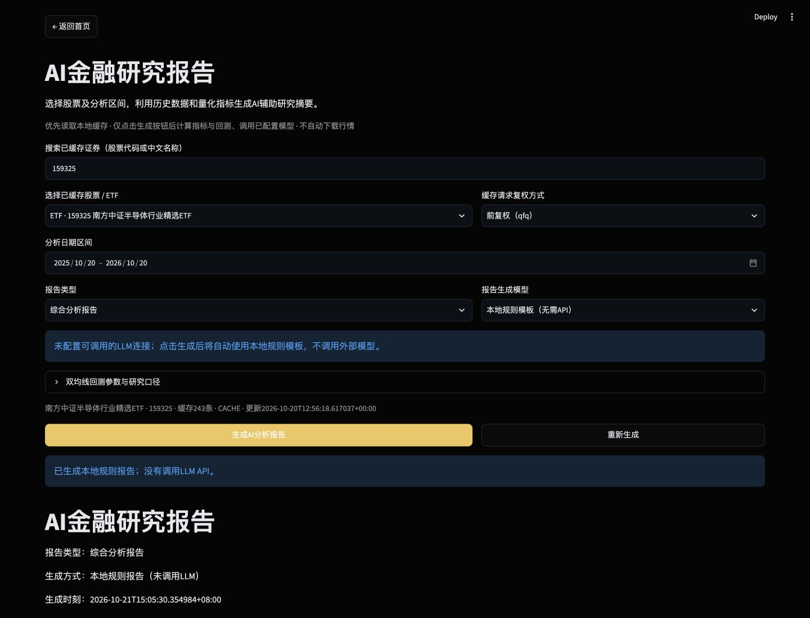
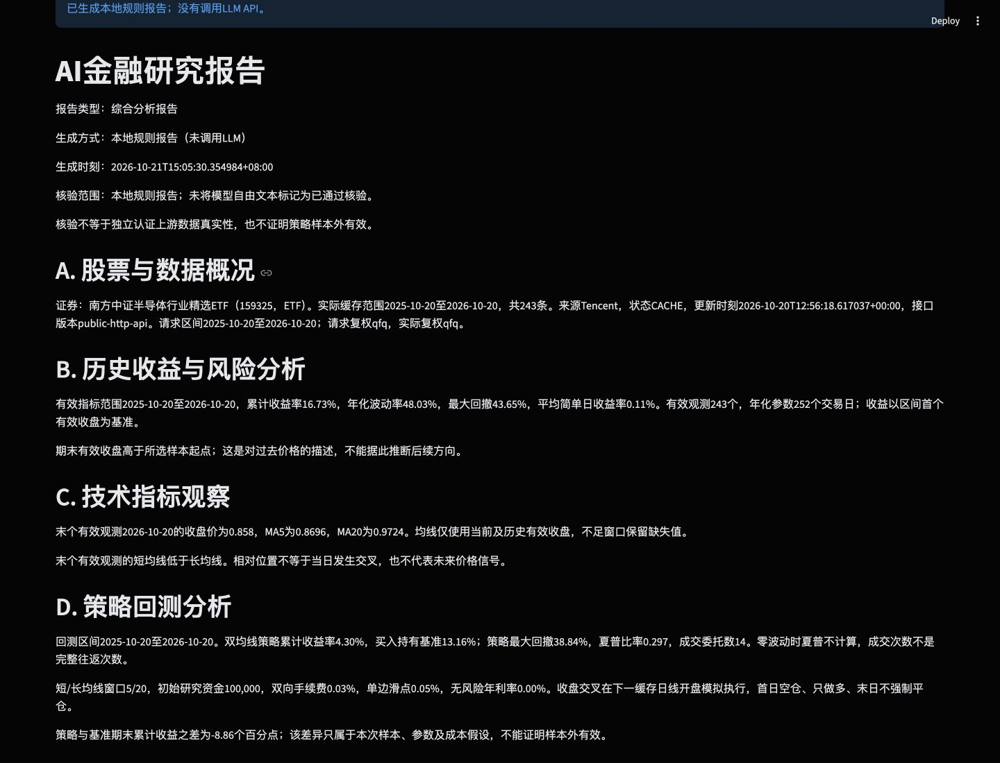

# 研究报告：设计、核验与验证

记录日期：2026-10-21。本阶段新增独立报告页面，复用已有股票/ETF缓存、金融指标和双均线研究回测。

## 使用方法

1. 在首页“进阶分析功能”点击“进入研究报告”。进入页面仅读取本地缓存目录，不计算回测、不请求行情或模型。
2. 输入代码/名称筛选**已缓存证券**，从选择器明确选择股票或ETF。未命中不代表证券不存在；使用“前往股票数据获取”搜索完整代码表并获取行情。
3. 选择缓存复权方式、日期和报告类型：历史表现、技术指标、双均线回测或综合分析。需要回测的报告可展开参数。
4. 点击“生成研究报告”。缺失整个区间时提示获取数据；部分覆盖时明确警告，只分析实际已有区间，不补齐或推断缺失日期。
5. 查看A—E分节报告及核验依据，下载Markdown和分析指标CSV。顶部可返回首页。
6. 相同配置与相同缓存再次点击生成只复用本次报告；“重新生成”才重新计算并调用所选模型。改变证券、日期、复权、类型、相关回测参数、模型或缓存后，旧报告与下载入口隐藏。

未配置模型也可以使用。普通规则报告、模型辅助报告、失败回退报告均明确区分。报告生成状态与股票行情的CACHE/STALE_CACHE状态分开表达。

## 数据流与模块职责

```text
首页导航 → ai_report/page.py（参数、显式按钮、状态与下载）
  → stock_data/service.py（缓存目录、只读区间数据）
  → ai_report/data.py：build_analysis
      → stock_analysis/indicators.py：calculate_indicators
      → backtest/engine.py：run_backtest（仅相关报告类型）
      → 结构化事实、适用句式、必须保留的限制、指标CSV
  → ai_report/service.py：generate_report
      → 无模型：本地规则计划
      → 有模型：prompts.py → models.py → validation.py
      → 结构/引用拒绝或API错误：回退本地规则计划
  → Python填入标准显示值 → Markdown、CSV、核验JSON
```

| 文件 | 作用 |
| --- | --- |
| `src/ai_report/page.py` | 缓存搜索、页面控件、模型配置读取、显式生成与重新生成、报告和下载 |
| `src/ai_report/data.py` | 输入契约校验、复用统计/回测、事实与句式构造、分析标识及指标CSV |
| `src/ai_report/prompts.py` | 独立系统任务与输入JSON模板，版本`grounded_plan_v2.0` |
| `src/ai_report/models.py` | 配置模型与单次HTTP调用；不硬编码服务地址、模型或密钥 |
| `src/ai_report/settings.py` | 智谱预设、自定义兼容API、会话级Key和显式连接测试 |
| `src/ai_report/validation.py` | 严格JSON解析、身份/日期/句式/引用校验及规则计划 |
| `src/ai_report/service.py` | 调用、拒绝回退、并发保护、受控Markdown渲染 |
| `app.py`、`src/home_page.py`、`src/navigation.py` | 新入口和页面路由 |
| `tests/test_ai_report.py`、`tests/test_ai_report_page.py` | 离线数据/模型/核验测试与Streamlit交互测试 |

没有新增采集器或依赖。OHLCV仍存于`data/stocks`，报告模块只读取匹配的股票或ETF缓存。

## 模型配置

三个配置项必须同时提供；环境变量优先于Streamlit Secrets：

| 配置项 | 内容 |
| --- | --- |
| `RESEARCH_LLM_MODEL` | 你实际有权限使用且支持所需协议的模型名称 |
| `RESEARCH_LLM_BASE_URL` | 兼容Chat Completions的API基础地址；不包含末尾`/chat/completions` |
| `RESEARCH_LLM_API_KEY` | 服务商提供的密钥 |

可参考`.streamlit/secrets.toml.example`在本机创建`.streamlit/secrets.toml`并填写；实际Secrets已被Git忽略。不要把密钥写入代码、截图或报告。配置后重启Streamlit。

页面仅列出完整配置的模型和本地规则模板，标签为“已配置，调用时验证”。数据管理页提供智谱GLM-4.7-Flash、GLM-5.3-Flash预设与自定义OpenAI兼容API；Key默认只保留在当前Streamlit会话，也可由用户明确选择保存到操作系统钥匙串。本地JSON只保存名称、模型和地址。保存配置不联网，只有“测试连接（调用1次）”、AI规则起草和报告生成按钮会发起请求。环境变量/Secrets、会话配置和凭据完整的本地配置可同时识别，相同模型和地址去重。

模型请求发送结构化统计JSON和受控句式，不发送API密钥以外的认证信息或全部历史行情。一次POST，无自动重试或重定向，连接超时5秒、读取超时25秒，输出上限4096 tokens；读取超时并非整个请求的严格总时限。拒绝输出、截断、HTTP错误、超时、响应异常均回退。远端要求HTTPS，本地服务可使用HTTP。

采用`response_format=json_object`要求返回JSON；JSON模式本身不保证业务结构与数值正确，仍由本地验证器严格检查。不同服务商和模型对参数的支持不同，不能仅凭配置完整宣称兼容。[官方结构化输出说明](https://developers.openai.com/api/docs/guides/structured-outputs?api-mode=chat)、[官方Chat Completions参数](https://developers.openai.com/api/reference/resources/chat/subresources/completions/methods/create)。

## 核验机制与边界

Python先计算所有统计值，生成`facts`（原始值、显示值、单位、计算来源）、`statements`（适用句式和字段引用）、`required`（各节必须保留内容）、证券、实际区间、警告及摘要。模型仅选择和排序适用句式，并原样回传引用值。最终文字由Python将规范显示值填入句式。

严格验证：

- 根JSON字段固定；拒绝重复键、NaN/Infinity、代码围栏、多余自由文本及异常结构。
- 证券代码、名称、类别、实际日期区间和分析标识完全匹配。
- A—E每节完整；仅接受本次Python判定适用的句式；风险与回测假设不可删除。
- 引用集合完整且无额外字段，原始值和类型匹配；空值不能换成0，布尔值不能冒充数字，四舍五入值不能替代原值。
- 不接受无法可靠核验的自由文本数值。被拒绝的模型原文不进入最终报告。
- 本地规则输出经过相同验证器。Markdown中的来源名称等文本经过转义。

这是一份**LLM辅助编排的受控报告**，并非自由长文生成。限制模型表达范围，才能对保留内容和引用提供明确保证。通过核验不等于独立认证上游行情真实性，不证明策略有效，也不能保证任意自由语言的金融推理正确。

缓存日期、OHLCV、唯一证券/名称/来源/实际复权口径在计算前校验；拒绝SAMPLE/DEMO标识及未来日期。不因页面点击而重新获取真实行情。缓存与参数签名包括数据内容摘要、元数据和Prompt版本，防止参数变化后误用旧报告；模板/统计契约变更时应同步升级版本。

## 指标与回测口径

报告复用可视化模块的指标函数：简单日收益`close_t/close_(t-1)-1`，累计收益`close_t/close_0-1`，样本标准差年化`std(ddof=1)*sqrt(252)`，最大回撤为收盘净值相对历史峰值下降幅度的最大值。均线不足窗口保留缺失值，不填未来值。

相关报告复用策略回测引擎，默认MA5/20、初始研究资金100000、双向手续费0.03%、单边滑点0.05%、无风险年利率0%、整手100研究单位。收盘交叉下一缓存日线开盘执行，首日空仓、只做多、末日不强平。回测使用首日开盘归一化为100的研究价格；不代表人民币现金流、真实股数或精确实盘可执行结果。历史收益以首个有效收盘为起点，回测基准以首日开盘并包含成本，二者口径不同。完整公式见[可视化文档](../03-visualization/01-VISUALIZATION.md)和[回测文档](../04-backtesting/01-BACKTEST.md)。

## 实际验证记录

### 自动化

在本机现有Python3.11.15、arm64虚拟环境执行：

```bash
cd "/Users/sky/Documents/Study/项目1-1"
.venv/bin/python -m pytest -q -p no:cacheprovider
.venv/bin/python -X pycache_prefix=/private/tmp/financial_platform_pycache -m compileall -q app.py src tests
```

| 检查 | 实际结果 |
| --- | --- |
| 修改前完整基线 | 359 passed，43.01秒 |
| 首轮新增测试 | 1 failed，71 passed；发现生成后重新生成按钮未立即启用 |
| 修复 | 成功生成后单次rerun刷新按钮；签名阻止再次调用模型 |
| 最终完整测试 | **436 passed，0 failed，48.31秒** |
| 新增AI数据/模型/核验测试 | 63项 |
| 新增AI页面交互测试 | 15项 |
| 原AI占位入口测试 | 1项已由实际页面导航与功能测试替换；359−1+78=436 |
| 编译检查 | 退出码0 |
| 实际外部LLM集成 | **NOT RUN：本机未配置模型/API Key**；配置连接、HTTP响应和模型流程以Mock离线测试验证 |

测试涵盖四类报告、指标复用一致性、短序列/空缓存/覆盖不足/异常价格/来源混用、证券与日期不符、篡改引用、缺失风险内容、无效JSON、空值/布尔/舍入陷阱、HTTP错误/超时/拒绝/截断回退、并发防护。页面测试阻断真实网络，验证未点击零调用、rerun和重复点击复用、重新生成恰好再调用一次、条件或缓存变化隐藏旧报告、首页返回及下载控件。

### 真实缓存页面与导出

本地启动命令：

```bash
.venv/bin/python -m streamlit run app.py --server.address 127.0.0.1 --server.port 18504 --server.headless true --browser.gatherUsageStats false
```

浏览器在`http://127.0.0.1:18504/`实际选择ETF159325（南方中证半导体行业精选ETF），2025-10-20至2026-10-20、前复权、综合分析。读取已有腾讯来源缓存243条，未下载新行情，生成方式为`LOCAL_RULES`。

| 统计 | 页面实际值 |
| --- | --- |
| 历史累计收益率 | 16.73% |
| 历史年化波动率 | 48.03% |
| 历史最大回撤 | 43.65% |
| 末个有效收盘 / MA5 / MA20 | 0.858 / 0.8696 / 0.9724 |
| 双均线策略 / 买入持有累计收益 | 4.30% / 13.16% |
| 策略最大回撤 / 夏普比率 / 成交委托数 | 38.84% / 0.297 / 14 |

分析标识：`2ab946c0355ec424bea5b5a8024d9b50a9a34a41def991f6c6f40b068e8dc6b9`。缓存摘要：`77e1ff9cf3fc9315473b53141adaf8623a5ca4f2448c31ac5b0c64c1cc9f460b`。这些为已有缓存下的历史样本结果，不能推广为未来收益。

实际点击两个下载按钮并检查本机下载文件：Markdown3335字节，包含本地规则标识、证券和A—E章节；CSV14480字节、55条事实，包含原始值、显示值、单位、来源、分析区间和同一分析标识。另行读取相同缓存重建分析，确认下载CSV与新计算导出字节完全相等、Markdown包含相同分析标识。浏览器自动化等待下载确认较慢，但两个文件已实际落盘，不只检查了按钮存在。





## 局限与后续验证

- 尚无真实外部模型账号/API连通性结果；不能把Mock通过写成真实LLM验收通过。
- 只搜索本地已缓存证券，补齐行情仍由原数据获取模块负责。
- 缺失、停牌和公司行为处理延续原指标与研究回测口径，报告披露警告，不额外伪造数据。
- 只支持受控句式编排和单个显式配置模型；自由长文、模型自动发现、报告数据库不在本阶段范围。
- 报告保存在当前会话，需通过下载持久保存；本机并发生成保护不用于多服务器任务调度。

本阶段未推送或部署。下一步应由用户验收页面，并在本机配置获准模型后，单独验证真实模型请求、回退与报告导出。
