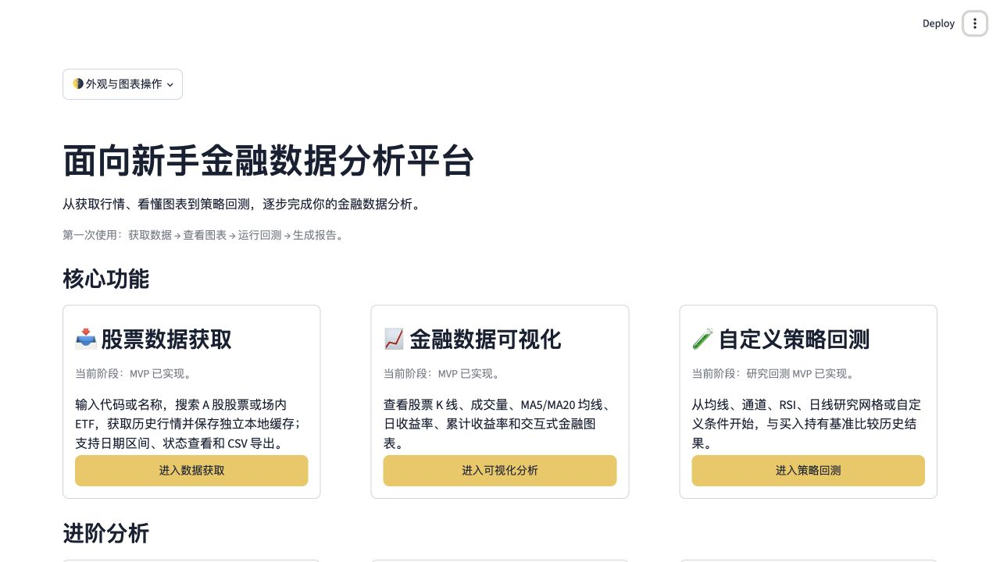

# 新手体验、策略与缓存升级记录

日期：2026-10-22。工作目录：`项目1-1`。本轮按用户确认方案执行；不部署、不推送，保留来源与许可。

## 1. 需求与实际交付

| 需求 | 本轮实现 | 验收边界 |
| --- | --- | --- |
| 平台名称 | 首页、浏览器标签、说明统一为“面向新手金融数据分析平台” | 已实现 |
| 按钮文字区域点击 | 顶部为原生页眉预留空间，限定按钮文本指针规则，避免自定义样式干扰 | 浏览器实际点文字中心验证两条返回路径 |
| 日期易用性 | 三个核心页面独立开始/结束、至今、近1/3/12个月快捷区间 | 本地provider-derived日历，不宣称交易所权威 |
| 策略扩展 | 均线、收盘通道、简单RSI、日线目标仓位网格、自定义条件 | 单证券归一化研究，不是精确实盘 |
| 缺数据获取 | 全市场代码/名称搜索、显式选择、小弹窗确认、复用原数据服务 | 搜索只读代码表或显式建立名单；历史行情需再确认 |
| 图表交互 | 独立边框卡片、标题说明、默认关闭滚轮缩放、显式开关 | 未实现悬停延时与跨浏览器精细捏合；采用用户认可的先行方案 |
| 明暗主题 | 右上角原生Theme：Light/Dark/System；原生控件和图表适配 | 不改全局配置文件来模拟单个用户切换 |
| 临时保存与管理 | 会话独立落盘、续租/过期清理、手工结束、转存永久、回收与恢复 | 不承诺浏览器关闭瞬间删除；永久缓存回收区仍占空间 |

## 2. 关键设计

### 日期与最后一根日线

`src/stock_data/calendar.py`离线读取`config/trading_calendar.json`，使用北京时间及15:00收盘边界。未收盘、周末及节假日选择上一已完成交易日；收盘后允许今天，但最终以实际返回日期为准。覆盖不足时不猜测工作日。

`src/date_controls.py`只调整日期与状态，不获取行情。年/月/日可以分开输入；三个核心模块保留独立日期控件及非widget研究状态。

股票缓存服务增加两处处理：旧缓存今日记录采集于收盘前或时间不明时标为待核验；收盘后显式获取会重取当天。已声明交易日的当日数据尚未由上游返回时，不把空的当天永久记为覆盖，方便用户主动重试。历史非交易日空结果仍沿用原成功查询口径。

### 临时落盘与清理

存储分开：

```text
data/stocks/                         永久OHLCV缓存
data/session_cache/<随机会话ID>/
  lease.json                         归属标记与活跃时间
  stocks/                            会话OHLCV，结构复用原CSV/JSON
data/cache_recovery/<随机条目ID>/     手工移出的可恢复缓存
```

临时模式是磁盘保存，不是纯内存模式；先复用已有永久数据的独立副本，再由原服务补缺。复制保留原更新时间和逐行采集时刻，不把复制等同于重新获取市场数据。永久文件不被临时获取修改。分析页、回测、AI报告通过统一工作区读取函数选择当前可用缓存。

应用活跃时每30秒用Streamlit fragment续租，运行中的后台清理线程每30秒检查一次；失去活跃信号600秒后回收。因此通常是失活约10分钟后、加一次扫描间隔，而不是关闭标签即删。断网、浏览器休眠或刷新导致会话失效时也可能过期；页面未点击不直接等于关闭。应用停止期间线程不运行，下次启动会检查过期残留。

只清理带项目归属标记、匹配随机ID的直属目录；拒绝符号链接、路径穿越或来源不明目录。当前进程内读写/转存与清理使用锁协调。此方案用于本机使用，不是多实例分布式存储。浏览器的“关闭事件”不作为必达通知，没有声称可靠区分所有断线与关页场景。

数据管理的“移除”是整份CSV/JSON移到回收区，可恢复且不覆盖已有永久条目；这不会立即释放回收区空间。临时转存也拒绝静默覆盖。成功操作使旧回测、报告和数据结果失效。应用不删除浏览器下载文件。

### 主题、按钮与图表

原自定义CSS曾固定背景/文字并压缩顶部间距。现在顶部留出原生工具栏空间，按钮p/span由按钮接收点击；实际浏览器检查文字中心命中按钮范围并完成返回。

当前全局页面不提供组件v2的主题CSS变量。自定义HTML采用继承字体和半透明`currentColor`背景/边框；图表清除写死的深色布局并交给Streamlit原生主题。主题切换无需重新下载数据或运行回测。使用右上角⋮中的Theme直接选择Light/Dark/System，顶部提供指引。

图表滚轮缩放默认关闭。顶部“外观与图表操作”内可以显式开启；框选、工具栏及时间滑块仍可用。暂未引入定制前端组件处理停留计时/捏合，以免把设备识别启发式当作可靠保证。

### 策略与AI规则草案

`run_backtest`保留旧双均线默认行为，增加可选`StrategySpec`；信号计算独立，仍先执行上日订单，再生成当日收盘信号。买入持有基准、费用、滑点、日期间隔等口径保留。

| 策略 | 收盘规则 |
| --- | --- |
| 均线 | 原MA交叉，原默认参数 |
| 通道 | 高于此前N日最高收盘进入，低于此前M日最低收盘退出，窗口不含今天 |
| RSI | 简单滚动平均涨/跌幅构造RSI，下穿低阈值进入，上穿高阈值退出；不冒称Wilder RSI |
| 日线网格 | 根据研究收盘档位得出目标仓位，下一开盘按资金/手续费/滑点和100模拟单位调仓 |
| 自定义 | 收盘、MA、简单RSI、成交量、有限常量；大小或交叉比较，每侧最多5条，all/any逻辑 |

网格不使用当日高低价推断日内顺序。上下边界使用首日开盘=100的研究尺度；跳空、成本、整手约束会使成交后仓位偏离目标。它不是日内多档限价撮合。自定义买卖同时成立时优先退出；成交量条件要求单位明确且统一。

可视化编辑器提供每侧1—3条条件，JSON契约最多5条。AI只在用户点击时接收描述并返回JSON草案，沿用已配置模型连接；本地拒绝未知字段、代码、非有限数、重复键和非法操作。用户必须审阅解释并确认，规则改变需重新确认；描述/模型改变后旧草案隐藏。未配置API时编辑器仍可用。

AI报告的回测分析仍明确为双均线，不会自动复用不匹配的网格或自定义策略结果。扩展报告策略范围不在本轮隐式完成。

## 3. 主要文件

新增：

- `src/date_controls.py`、`src/ui_experience.py`：共享日期、主题适配、图表与会话续租。
- `src/stock_data/calendar.py`：离线交易日和完整日线边界。
- `src/stock_data/session_cache.py`：归属验证、租约、清理线程与写入保护。
- `src/stock_data/workspace.py`：统一临时/永久读取，复用原下载服务。
- `src/stock_data/inline_fetch.py`：显式搜索、缺数据确认弹窗。
- `src/stock_data/management.py`：缓存清单、转存、回收恢复与清理。
- `src/backtest/strategies.py`、`strategy_controls.py`、`rule_assistant.py`：规则计算、通俗参数界面、可选AI草案。
- `tests/test_platform_improvements.py`：50项新增离线测试（含参数化）。

修改：首页、导航、`app.py`和产品名；数据获取/可视化/回测/报告的缓存读取；缓存服务的日线最终状态；回测引擎可选策略和图表标签；主题配置、Git忽略、界面测试及说明书。

本轮没有重写整个`app.py`或另建采集系统，没有增加第三方依赖。修改前保存了不含数据、密钥的本地源文件快照，用于核对变更。

## 4. 实际测试

环境沿用macOS Apple Silicon / Python3.11.15 / Streamlit1.66.0。

```bash
cd "/Users/sky/Documents/Study/项目1-1"
.venv/bin/python -m pytest -q -p no:cacheprovider
.venv/bin/python -X pycache_prefix=/private/tmp/novice_platform_pycache -m compileall -q app.py src tests
```

- 修改前：`436 passed in 47.04s`。
- 首轮相关回归：`9 failed, 86 passed`，失败对应用户要求改变的旧名称、合并日期控件和占位页断言。
- 后续新增测试发现弹窗打开状态在整页重绘时丢失；改为显式会话状态并正确处理关闭/确认，再通过复测。
- 编写测试时还修正了异常类型断言、AppTest会话访问方式及网络模式参数预期；没有为通过测试放宽数据契约。
- 最终完整回归：**`486 passed in 50.49s`，0失败**。原436项继续保留行为覆盖，新增50项。完整原始输出见[最终pytest日志](../07-validation/test-results/01-PLATFORM_PYTEST_2026-10-22.txt)。
- 视觉核对发现按钮文字对比度问题，修正主题样式并增加回归断言；缓存复制测试改为比较两份持久化后的表格，避免将CSV正常类型转换误判为数值变化。
- 最终编译检查退出码0。

新增覆盖：交易日/时区/收盘边界、快捷日期、临时缓存复用及永久文件不变、过期与归属保护、路径/符号链接、回收失败回滚、转存与恢复、所有策略次日执行与未来扰动不影响历史、网格费用/分批仓位、RSI边界、自定义JSON及单位、AI显式调用与旧草案失效、弹窗确认和重复运行不下载、图表滚轮开关、策略首页往返保留。

### 浏览器实际验证

本地应用：`http://127.0.0.1:18505/`，默认浏览器视口1280×720。

- 首页和浏览器标题为新名称；三个主要入口及数据管理可访问。
- 在浏览器滚回顶部后，通过按钮文字中心坐标实际点击“返回可视化分析”“返回首页”，均到达目标页面；文字中心命中按钮内部元素，没有被覆盖。
- 原生Theme从System切换Dark、再Light，两种模式均显示。
- 真实ETF159325缓存243条，2025-10-20—2026-10-20、前复权，默认研究网格边界80/120、5档：页面显示策略累计收益12.21%、基准13.16%、策略最大回撤5.68%、成交35次。这只是该历史缓存和研究假设的结果。
- 数据获取选择“仅本次使用”，复用同区间已存在的真实永久缓存，得到CACHE并在会话目录保存副本；未重新请求行情。可进入可视化和数据管理，后者分别列出永久/本次临时条目。
- 对原ETF永久CSV/JSON前后SHA256比较，二者均未改变。真实永久数据没有用于删除/恢复测试；相关破坏场景在pytest临时目录执行。

NOT RUN：真实外部LLM规则草案调用（无API配置）、跨浏览器精细手势、真实关页后等待完整10分钟清理周期。租约失效/重启兜底已通过离线时间控制测试，不冒称实测了所有浏览器关闭情形。

## 5. 页面截图



[深色首页](../08-assets/screenshots/platform_home_dark.jpg) · [真实缓存研究网格](../08-assets/screenshots/platform_grid.jpg) · [临时缓存管理](../08-assets/screenshots/platform_cache.jpg)

## 6. 使用建议

停止旧应用后，从项目目录重新运行Streamlit。先使用已有缓存检查日期、图表和新策略，再体验临时保存和数据管理。行情数据与AI模型各有独立网络边界，不能用其中一项成功推断另一项可用。

面试解释可以概括为：“我把一次研究过程变成显式、可追溯的工作流：统一读接口隔离存储生命周期，策略只定义收盘规则，账户引擎处理次日执行；用离线样例验证边界，并把外部接口不可用如实呈现。”
